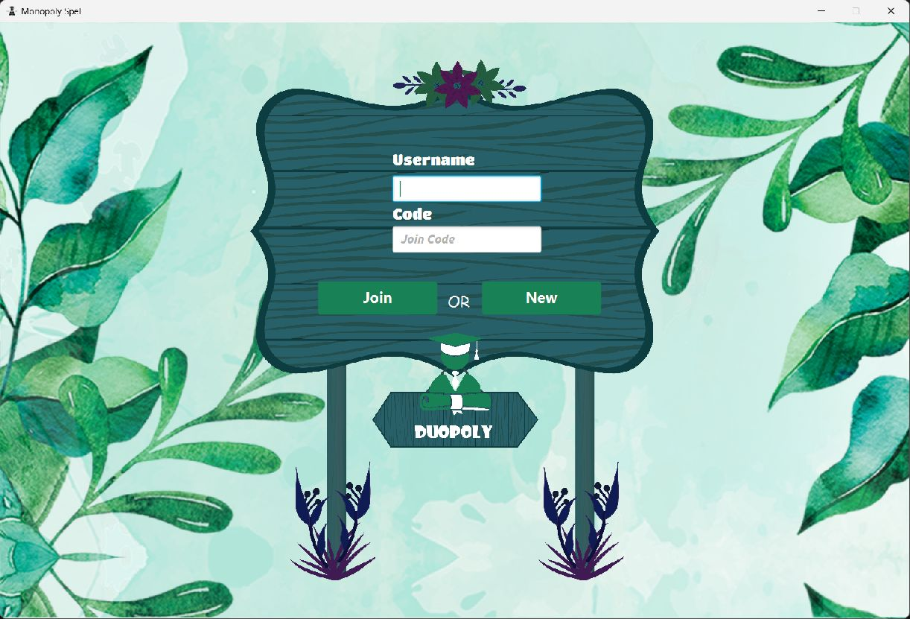
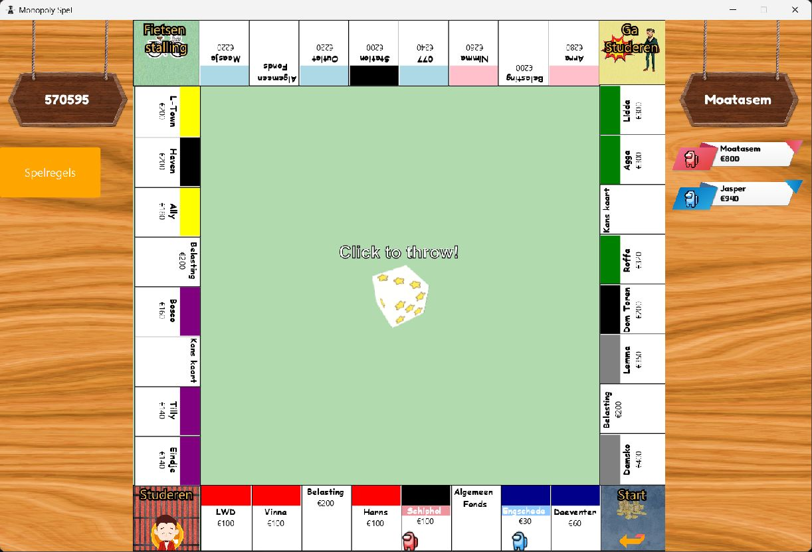
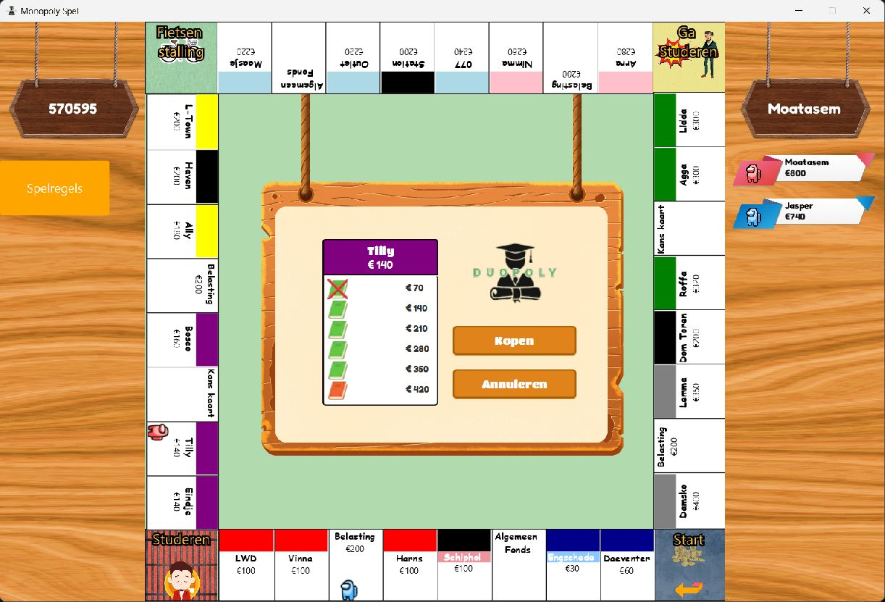

# Duopoly / Monopoly Project

## Screenshots

### Main menu



### Gameplay



### Property purchase



## Nederlands

Dit project is een Monopoly-geinspireerd spel met een humoristische, satirische stijl.
Het is geen 1-op-1 kopie van het origineel, maar een studentikoze parody met aangepaste namen en events.

### Over het project

- Dit is een schoolproject voor Hogeschool Leiden.
- Het project is ontwikkeld door een team van 4 personen.

### Vereisten

- JDK 17
- JavaFX

### Firebase service account sleutel (belangrijk)

Dit project heeft een Firebase service account key nodig om Firestore te gebruiken.

- Bestandsnaam moet exact zijn: `key.json`
- Plaats het bestand op dit pad: `src/main/resources/serviceAccountKey/key.json`

Let op: dit bestand bevat gevoelige gegevens en staat daarom niet in Git.

Let op: het project gebruikt Maven met de JavaFX plugin. Zorg dat Java 17 en JavaFX correct zijn ingesteld.

### Gameconcept (humoristische Monopoly-variant)

- De game volgt de kern van Monopoly, maar niet exact 1:1.
- Meerdere vakken en events zijn bewust aangepast met een satirische toon.
- Voorbeeld: in plaats van gevangenis is er Studeren / ga studeren.
- De kern blijft: dobbelen, bewegen, kopen, huur innen en verrassingskaarten.

### Beschikbare features

- Een game maken of joinen via een Game ID.
- Synchronisatie van gamestate tussen spelers via Firebase/Firestore.
- Beurtsysteem met actieve speler-tracking.
- Dobbelen en spelerverplaatsing op basis van de worp.
- Meerdere vaktypes op het bord:
	- START
	- PROPERTY
	- BELASTING
	- KANS
	- ALGEMEENFONDS
	- Speciale vakken zoals GASTUDEREN
- Vastgoed kopen wanneer een vak nog geen eigenaar heeft.
- Huur betalen bij vakken van andere spelers.
- Huizen bouwen onder balansvoorwaarden.
- Kans- en Algemeen Fonds-kaarten met geld- en locatie-events.
- Spelregels-scherm (Spelregels).
- Muziek en geluidseffecten tijdens gameplay.
- Spelerlijst, eindstatus en winnaarsoverlay in de UI.

### Starten

1. Zorg dat JDK 17 en JavaFX geinstalleerd zijn.
2. Start het project vanuit de projectmap met:

```bash
mvn clean javafx:run
```

3. In de game:
- Maak een sessie aan of join een bestaande sessie.
- Vul een naam in (of laat leeg voor een willekeurige naam).

## English

This project is a Monopoly-inspired game with a humorous, satirical style.
It is not a 1:1 clone of the original, but a light parody with student-themed names and events.

### About the project

- This is a school project for Hogeschool Leiden.
- The project was built by a team of 4 people.

### Requirements

- JDK 17
- JavaFX

### Firebase service account key (important)

This project requires a Firebase service account key to connect to Firestore.

- The file name must be exactly: `key.json`
- Place the file at: `src/main/resources/serviceAccountKey/key.json`

Note: this file contains sensitive credentials and is intentionally not tracked in Git.

Note: the project uses Maven with the JavaFX plugin. Make sure Java 17 and JavaFX are configured correctly.

### Game concept (satirical Monopoly variant)

- The game follows the core Monopoly loop, but not as an exact copy.
- Several tiles and events are intentionally adapted with a satirical tone.
- Example: instead of jail, the game uses Studeren / ga studeren.
- Core loop remains: roll dice, move, buy, collect rent, and draw event cards.

### Available features

- Create or join a game room using a Game ID.
- Multiplayer game state synchronization via Firebase/Firestore.
- Turn-based flow with active-player tracking.
- Dice rolling and movement based on roll output.
- Multiple board tile types:
	- START
	- PROPERTY
	- BELASTING (tax)
	- KANS (chance)
	- ALGEMEENFONDS
	- Special tiles like GASTUDEREN
- Buy properties when unowned.
- Pay rent on properties owned by other players.
- Build houses when balance conditions are met.
- Kans and Algemeen Fonds cards with money and movement effects.
- Rules screen (Spelregels).
- In-game music and sound effects.
- UI for player list, end state, and winner display.

### Run

1. Ensure JDK 17 and JavaFX are installed.
2. From the project root, run:

```bash
mvn clean javafx:run
```

3. In the game:
- Create a new session or join an existing one.
- Enter a username (or leave blank for a random one).

## العربية

هذا المشروع لعبة مستوحاة من Monopoly بطابع فكاهي ساخر.
اللعبة ليست نسخة مطابقة للأصل، بل Parody خفيفة مع أسماء وأحداث أقرب لجو الطلبة.

### عن المشروع

- هذا مشروع مدرسي لمدرسة Hogeschool Leiden.
- تم تطوير المشروع بواسطة فريق مكوّن من 4 أشخاص.

### المتطلبات

- JDK 17
- JavaFX

### مفتاح Firebase service account (مهم)

هذا المشروع يحتاج ملف Firebase service account key حتى يعمل الاتصال مع Firestore.

- يجب أن يكون اسم الملف بالضبط: `key.json`
- ضع الملف في هذا المسار: `src/main/resources/serviceAccountKey/key.json`

ملاحظة: هذا الملف يحتوي بيانات حساسة، لذلك غير مرفوع على Git.

ملاحظة: المشروع يستخدم Maven مع JavaFX plugin، لذلك يجب تجهيز Java 17 وJavaFX بشكل صحيح قبل التشغيل.

### فكرة اللعبة (نسخة فكاهية من Monopoly)

- اللعبة تقلد Monopoly ولكن ليست مطابقة 1:1.
- تم تعديل بعض المربعات والأحداث بروح ساخرة.
- مثال واضح: بدل السجن، يوجد Studeren / ga studeren.
- النمط الأساسي بقي نفسه: رمي نرد، حركة، شراء، إيجار، وبطاقات مفاجآت.

### الميزات المتاحة

- إنشاء غرفة لعب أو الانضمام إليها عبر Game ID.
- مزامنة حالة اللعبة بين اللاعبين عبر Firebase/Firestore.
- نظام أدوار مع تتبع اللاعب النشط.
- رمي النرد وتحريك اللاعب حسب نتيجة الرمية.
- أنواع متعددة من المربعات على اللوحة مثل START وPROPERTY وBELASTING وKANS وALGEMEENFONDS وGASTUDEREN.
- شراء العقارات، دفع الإيجار، وبناء البيوت حسب الرصيد.
- بطاقات Kans وAlgemeen Fonds بأحداث مالية وحركية.
- شاشة قوانين اللعبة (Spelregels).
- موسيقى ومؤثرات صوتية داخل اللعبة.
- واجهة تعرض قائمة اللاعبين وحالة النهاية والفائز.

### التشغيل

1. تأكد من تثبيت JDK 17 وJavaFX.
2. من مجلد المشروع شغّل:

```bash
mvn clean javafx:run
```

3. داخل اللعبة:
- أنشئ جلسة جديدة أو انضم إلى جلسة موجودة.
- أدخل اسمك (أو اتركه فارغًا للحصول على اسم عشوائي).
